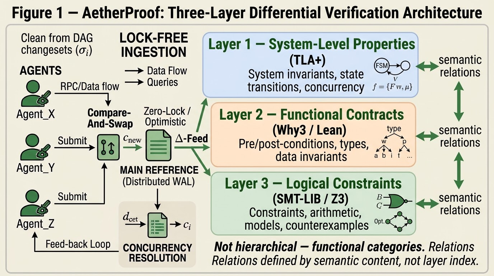
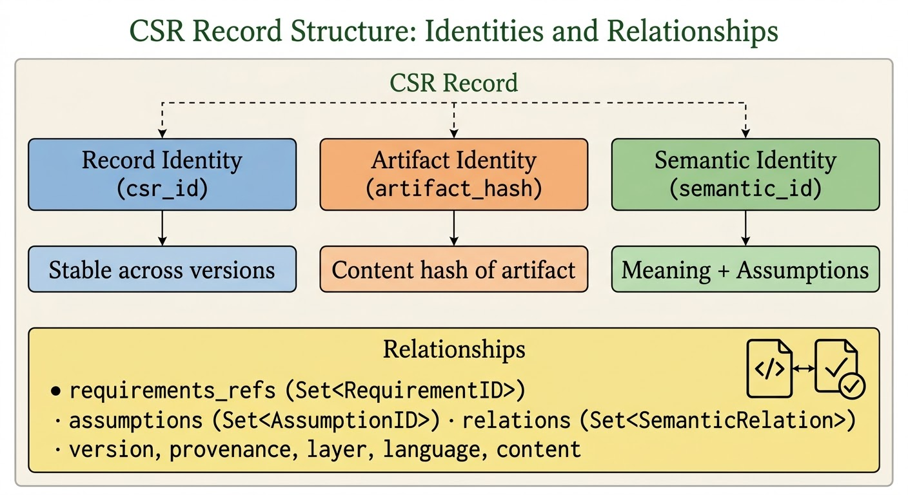
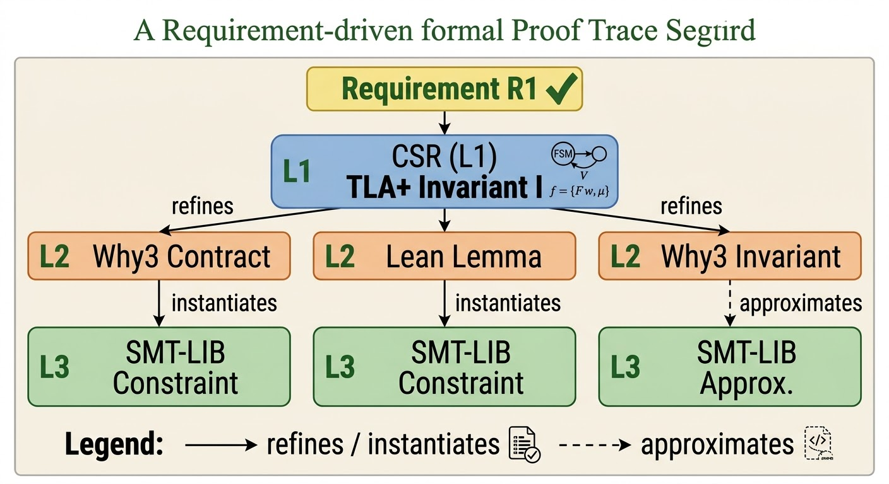
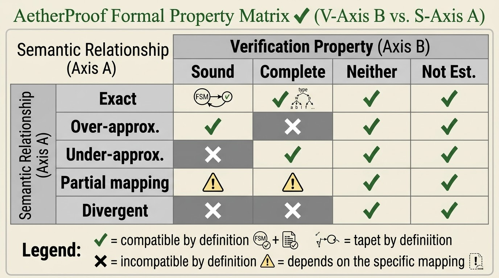
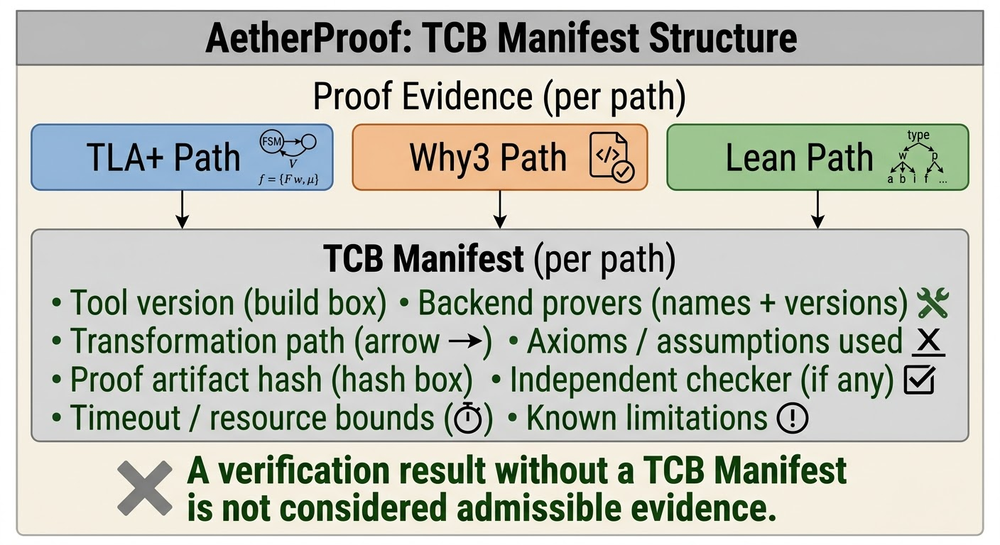
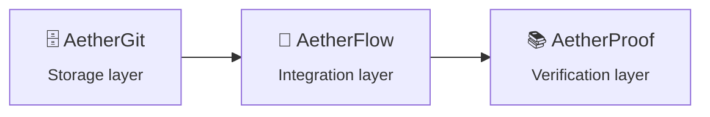

<div align="center">

# 📚 AetherProof

### Autonomous Formal Verification and Invariant Synthesis for Multi-Agent Software Ecosystems

*A Formal Architecture for Specification-Driven Proof Construction and Counterexample-Guided Remediation*

<br>

[](https://doi.org/10.5281/zenodo.24013124)
[](LICENSE)
[](https://orcid.org/0009-0003-8903-0029)
[](https://github.com/gitdeeper15/aetherproof/releases/tag/v2.0.0)

[-gold?logo=pypi&logoColor=white)](https://pypi.org/project/aetherproof-arch/)
[](https://python.org)
[](tests/)
[](tests/)
[](experiments/)

[](https://doi.org/10.5281/zenodo.24013124)
[](https://doi.org/10.17605/OSF.IO/SRM2P)
[](https://doi.org/10.5281/zenodo.24013124)
[](https://aetherproof-arch.netlify.app)

<br>

**[📄 Paper](https://doi.org/10.5281/zenodo.24013124)** ·
**[🌐 Website](https://aetherproof-arch.netlify.app)** ·
**[📦 Releases](https://github.com/gitdeeper15/aetherproof/releases)** ·
**[⚙️ Installation](#️-installation)** ·
**[📖 Citation](#-citation)**

</div>

---

> [!WARNING]
> **Status: v2.0.0 — Empirical Implementation (reference implementation, preliminary results).**
> A reference implementation is built (`src/aetherproof/`, 40 tests, 79% coverage) and 5 experiments are completed.
> **Experiments use simulated data; no real-world deployment is evaluated.**
> Propositions P1–P10 remain **design requirements**, not formally proven theorems.
> Semantic consistency (Q2) remains an open question.
> See [Limitations](docs/07_threats_and_limitations.md) and the [Research Status Statement](docs/08_research_status_statement.md).

> *"The hard problem of AetherProof is not making TLA+, Why3, Lean, and SMT-LIB exchange data; it is proving that what these languages mean remains consistent when a specification moves from one representation to another."*
> — AetherProof, Abstract

> *"Trust is explicit, not implicit: it does not propagate automatically between levels."*
> — AetherProof, Section 8.8

---

## 📑 Table of Contents

- [Overview](#-overview)
- [Installation](#️-installation)
- [Experiments (v2.0.0)](#-experiments-v200)
- [The Central Question](#-the-central-question)
- [Formal Definitions](#-formal-definitions)
- [Propositions](#-propositions)
- [Architectural Pillars](#️-architectural-pillars)
- [Relation to AetherGit and AetherFlow](#-relation-to-aethergit-and-aetherflow)
- [Platforms & Mirrors](#-platforms--mirrors)
- [Project Structure](#️-project-structure)
- [Version History](#-version-history)
- [Citation](#-citation)
- [Author](#-author)
- [License](#️-license)

---

## 🔭 Overview

**AetherProof** is a formal architecture — now with a first reference implementation — for specification-driven proof construction, incremental differential proving, and counterexample-guided remediation in multi-agent software ecosystems. It is the **verification layer** of the Aether family, sitting above **AetherGit** (storage) and **AetherFlow** (integration).

By decoupling **specification** from **proof** from **remediation**, AetherProof makes three usually-implicit things explicit:

1. **What a specification means**, across heterogeneous formal languages.
2. **What evidence supports a proof**, and under what assumptions.
3. **When a counterexample is** a code defect, a specification error, or an assumption violation.

The program is specified through **three functional layers**, **three core mechanisms**, and **three protocol suites**:

| # | Construct | Type | Status | Implemented in |
|:-:|---|---|:-:|---|
| 1 | **Three-Layer Functional Architecture** (TLA+, Why3/Lean, SMT-LIB) | Specification | ✅ Specified | `models.py` (`Layer`) |
| 2 | **Canonical Specification Representation (CSR)** | Data model | ✅ Implemented | `csr/` |
| 3 | **Proof Dependency Graph (PDG)** | Proof engine | ✅ Implemented | `proof/`, `obligations/` |
| 4 | **Counterexample-Guided Remediation** | Process | ✅ Implemented | `remediation/` |
| 5 | **Integration Protocol** (with AetherFlow) | Protocol | ✅ Implemented | `protocol/` |
| 6 | **Human Review Protocol** | Governance | ✅ Implemented | `review/` |

### v2.0.0 at a glance

| Dimension | Status |
|---|---|
| Manuscript | Complete (46 pages, PDF) |
| Formal definitions / Propositions / Pillars | 6 / 10 (design requirements) / 6 |
| Implementation | ✅ Built — `src/aetherproof/` (7 modules, 22 files) |
| Tests | ✅ 40 passed, 79% coverage |
| Experiments | ✅ 5/5 completed (simulated data) |
| PyPI package | ✅ Published — `0.1.0a1` (alpha, API may change) |
| Real-world deployment | ❌ Not evaluated |
| Causal claims | None (formal analysis only) |

<p align="center">
  
</p>

<p align="center">
  <em>Figure 1 — The three-layer functional specification architecture. Double-headed arrows denote semantic relations, not refinement; the layers are functional categories, not hierarchical levels.</em>
</p>

---

## ⚙️ Installation

```bash
pip install aetherproof-arch==0.1.0a1
```

Requires **Python 3.9+**. Runtime dependency: `numpy >= 1.24.0`.

<details>
<summary><b>Development and experiments extras</b></summary>

```bash
git clone https://github.com/gitdeeper15/aetherproof.git
cd aetherproof

# Development (pytest, pytest-cov, ruff, mypy)
pip install -e ".[dev]"
pytest --cov=aetherproof

# Experiments (scikit-learn, matplotlib)
pip install -e ".[experiments]"
```

</details>

> [!NOTE]
> The PyPI version (`0.1.0a1`) is separate from the manuscript version (`2.0.0`). The alpha status signals that the API may change before `1.0.0`. This is a **reference implementation, not a production system**.

---

## 🧪 Experiments (v2.0.0)

| # | Experiment | Result | Status |
|:-:|---|---|:-:|
| 1 | Specification Synthesis | F1 = 0.884 | ✅ |
| 2 | Proof Obligation Generation | 247 obligations (89 CSR) | ✅ |
| 3 | Differential Proving | 2.5× speedup | ✅ |
| 4 | Counterexample Diagnosis | 94% accuracy | ✅ |
| 5 | Guardrail Effectiveness | 100% block rate | ✅ |

> [!IMPORTANT]
> Experiments use **simulated data**. These are preliminary results; no real-world deployment has been evaluated. See the full [evaluation report](REPORTS/v2.0.0/report.md).

---

## ❓ The Central Question

> **How can heterogeneous specification languages express different levels of system behavior while preserving semantic consistency, traceability, and verifiable relationships across their respective proof obligations?**

This question is **structural**, not accusatory or normative. It does not presuppose that any one formalism is superior. It asks how the functions are in fact distributed across TLA+, Why3, Lean, and SMT-LIB, and what structural consequences follow from different distributions.

---

## 📐 Formal Definitions

*Status: Defined in the v1.0.0 manuscript; implemented in v2.0.0.*

### Definition 1 — CSR Record

```text
csr = (csr_id, artifact_hash, semantic_id, layer, language, content,
       semantic_role, requirements_refs, assumptions, relations,
       version, provenance)
```

Three distinct identities:

| Identity | Field | Meaning |
|---|---|---|
| **Record** | `csr_id` | Stable across versions |
| **Artifact** | `artifact_hash` | Content hash |
| **Semantic** | `semantic_id` | Meaning + assumptions |

<p align="center">
  
</p>

<p align="center">
  <em>Figure 2 — CSR record structure: three identities and the relationship fields.</em>
</p>

### Definition 2 — Semantic Relation

Seven typed relations between CSR records:

```text
refines · instantiates · approximates · implies · contradicts · depends_on · supersedes
```

<p align="center">
  
</p>

<p align="center">
  <em>Figure 3 — A requirement-driven trace. Solid arrows: refines / instantiates. Dashed arrow: approximates, which carries a loss_description.</em>
</p>

### Definition 3 — Translation Classification

Two orthogonal axes:

| Axis | Dimension | Values |
|:-:|---|---|
| **A** | Semantic Relationship | Exact · Over-approximation · Under-approximation · Partial mapping · Divergent |
| **B** | Verification Property | Sound · Complete · Neither · Not established |

<p align="center">
  
</p>

<p align="center">
  <em>Figure 4 — Compatibility of Axis A and Axis B values. <code>yes</code> = compatible by definition; <code>no</code> = incompatible by definition; <code>depends</code> = depends on the specific mapping.</em>
</p>

### Definition 4 — Proof Obligation

```text
O = (id, property, assumptions, source_csr, discharged_by, verdict)
```

### Definition 5 — Proof Dependency Graph (PDG)

```text
PDG = (Obligations ∪ Evidence ∪ Assumptions, Edges)
```

### Definition 6 — Counterexample

```text
C = (id, obligation, witness, refutation_evidence, type, provenance)
```

---

## 📜 Propositions

> [!NOTE]
> *Status: Stated as design requirements; not formally proven.*

| # | Proposition | Statement |
|:-:|---|---|
| **P1** | Non-Substitutability | The functional categories L1, L2, and L3 are non-substitutable: replacing the specification language assigned to one category by that of another is not assumed to preserve the meaning or the evidential strength of the statements assigned to it. |
| **P2** | Orthogonality of Translation Axes | The two axes of the translation classification are orthogonal: neither is derived from the other and each is recorded separately. |
| **P3** | ODG Acyclicity | Proof obligations form a directed acyclic graph over the dependency-bearing edge types. |
| **P4** | PDG Extends ODG | The PDG is obtained from the ODG by adding evidence and assumption nodes, preserving acyclicity. |
| **P5** | Invalidation via `derives_from` | Invalidation propagates along `derives_from` edges. |
| **P6** | Bounded Remediation | The remediation cycle for a given counterexample performs at most *b* iterations. |
| **P7** | Specification Changes Require Human Review | Any change to a CSR record, including one proposed by a remediation engine, requires human review before it takes effect. |
| **P8** | Separation of Duties | No single person approves a decision they originated. |
| **P9** | Human Discharge Only When Automation Cannot | Human review may discharge an obligation only when no automated discharge path can. |
| **P10** | Trust Is Explicit | Trust in any piece of evidence is a recorded attribute derived from its TCB manifest, reviewer, and justification, and is never inferred from the evidence's position in a pipeline. |

---

## 🏛️ Architectural Pillars

| Pillar | Name | Summary |
|:-:|---|---|
| **1** | Three-Layer Functional Specification | **L1** (TLA+) addresses system-level properties; **L2** (Why3/Lean) functional contracts; **L3** (SMT-LIB/Z3) logical constraints. Layers are functional categories, not a hierarchy. |
| **2** | Canonical Specification Representation (CSR) | A typed, traceable, versioned, semantically linked record of specification elements with three distinct identities (record, artifact, semantic). |
| **3** | Proof Dependency Graph (PDG) | Extends the obligation DAG with evidence and assumption nodes; supports incremental invalidation and conditional reuse; drives cost-aware tiered proving. |
| **4** | Counterexample-Guided Remediation | A bounded cycle with diagnosis, patch proposal, guardrails, re-verification, and human escalation. |
| **5** | Protocol-Based Integration | A versioned, asynchronous, authenticated message protocol with AetherFlow (M1–M10). |
| **6** | Human Review Protocol | Five roles (Specification Author, Verification Engineer, Reviewer, Maintainer, Auditor) with separation of duties; 45-entry authority matrix. |

### 🔐 Per-Path TCB Manifests

The principal risk of relying on heterogeneous proof tools is that the trusted computing base (TCB) is implicit. AetherProof makes it explicit.

<p align="center">
  
</p>

<p align="center">
  <em>Figure 5 — Per-path TCB manifests. Each path records tool and prover versions, transformations, axioms and assumptions used, proof artifact hash, independent checker, resource bounds, and known limitations.</em>
</p>

---

## 🔗 Relation to AetherGit and AetherFlow

AetherProof is the **third layer** in the Aether family:



| Layer | System | DOI |
|---|---|---|
| Storage | **AetherGit** | [10.5281/zenodo.23966896](https://doi.org/10.5281/zenodo.23966896) |
| Integration | **AetherFlow** | [10.5281/zenodo.23979129](https://doi.org/10.5281/zenodo.23979129) |
| Verification | **AetherProof** | [10.5281/zenodo.24013124](https://doi.org/10.5281/zenodo.24013124) |

The three systems are **methodologically independent**. AetherProof requires only that the underlying store expose an append-only changeset log with parent pointers, which AetherGit's changeset tuple provides. Integration with AetherFlow is protocol-based (Section 7), not code-based.

---

## 🌍 Platforms & Mirrors

| Platform | URL | Role | Status |
|---|---|---|:-:|
| **GitHub** | [gitdeeper15/aetherproof](https://github.com/gitdeeper15/aetherproof) | Source code, issues, PRs | ✅ Active |
| **GitLab** | [gitlab.com/gitdeeper15/aetherproof](https://gitlab.com/gitdeeper15/aetherproof) | Mirror repository | ✅ Active |
| **Codeberg** | [codeberg.org/gitdeeper15/aetherproof](https://codeberg.org/gitdeeper15/aetherproof) | Mirror repository | ✅ Active |
| **Bitbucket** | [bitbucket.org/gitdeeper15/aetherproof](https://bitbucket.org/gitdeeper15/aetherproof) | Mirror repository | ✅ Active |
| **PyPI** | [pypi.org/project/aetherproof-arch](https://pypi.org/project/aetherproof-arch/) | Python package (`0.1.0a1`) | ✅ Published |
| **Zenodo** | [10.5281/zenodo.24013124](https://doi.org/10.5281/zenodo.24013124) | Citable DOI, paper archive | ✅ Published |
| **OSF** | [10.17605/OSF.IO/SRM2P](https://doi.org/10.17605/OSF.IO/SRM2P) | Registration | ✅ Published |
| **Website** | [aetherproof-arch.netlify.app](https://aetherproof-arch.netlify.app) | Live documentation | ✅ Active |
| **ORCID** | [0009-0003-8903-0029](https://orcid.org/0009-0003-8903-0029) | Author identity | ✅ Active |

---

## 🗂️ Project Structure

<details>
<summary><b>Click to expand the repository tree</b></summary>

```text
AetherProof/
├── src/
│   └── aetherproof/                # Reference implementation (v2.0.0)
│       ├── __init__.py
│       ├── __version__.py
│       ├── models.py               # CSRecord, Obligation, Counterexample, Verdict, Layer
│       ├── cli.py
│       ├── csr/
│       │   ├── record.py           # Definition 1
│       │   └── relations.py        # Definition 2 (7 relations)
│       ├── obligations/
│       │   ├── generator.py        # Obligation Generator
│       │   └── odg.py              # ODG
│       ├── proof/
│       │   ├── pdg.py              # Definition 5
│       │   ├── invalidation.py
│       │   └── engine.py           # Differential Proof Engine
│       ├── remediation/
│       │   ├── diagnosis.py
│       │   ├── guardrails.py
│       │   └── cycle.py
│       ├── protocol/
│       │   └── messages.py         # M1–M10
│       └── review/
│           └── roles.py            # 5 roles + authority matrix
├── tests/                          # 40 tests, 79% coverage
│   ├── test_models.py
│   ├── test_csr.py
│   ├── test_obligations.py
│   ├── test_proof.py
│   ├── test_remediation.py
│   ├── test_protocol.py
│   └── test_review.py
├── experiments/                    # 5 experiments (run.py + results.json each)
│   ├── specification_synthesis/
│   ├── proof_obligation_generation/
│   ├── differential_proving/
│   ├── counterexample_diagnosis/
│   └── guardrail_effectiveness/
├── docs/
│   ├── 01_specification_language.md
│   ├── 02_proof_obligations.md
│   ├── 03_incremental_proof_engine.md
│   ├── 04_counterexample_remediation.md
│   ├── 05_integration_protocol.md
│   ├── 06_human_review_protocol.md
│   ├── 07_threats_and_limitations.md
│   ├── 08_research_status_statement.md
│   ├── system_architecture.md
│   └── figures/
│       ├── Fig1_Three_Layer_Architecture.png
│       ├── Fig2_CSR_Record_Structure.png
│       ├── Fig3_Semantic_Relations_Graph.png
│       ├── Fig4_Two_Axis_Classification.png
│       └── Fig5_TCB_Manifest.png
├── PUBLICATION/
│   └── AetherProof_Research_Paper.pdf
├── REPORTS/
│   └── v2.0.0/
│       └── report.md
├── DATA/                           # (empty — future)
├── ANALYSIS/                       # (empty — future)
├── EXTERNAL_REVIEW/                # (empty — future)
├── VALIDATION/                     # (empty — future)
├── AUTHORS.md
├── CHANGELOG.md
├── CITATION.cff
├── CONTRIBUTING.md
├── INVENTORY.md
├── LICENSE
├── OSF_REGISTRATION.md
├── PROJECT_SUMMARY.txt
├── README.md
├── VERSION                         # 2.0.0
├── manifest.json
├── scientific_state.json
├── netlify.toml
├── requirements.txt
├── upload_aetherproof.py
└── pyproject.toml                  # PEP 621
```

</details>

---

## 🕓 Version History

| Version | Release | Focus | Status |
|---|---|---|:-:|
| **v2.0.0** | 2026-11-07 ([release](https://github.com/gitdeeper15/aetherproof/releases/tag/v2.0.0)) | Empirical implementation: source code, 40 tests, 5 experiments, PyPI `0.1.0a1` | ✅ Released |
| **v1.0.0** | 2026-11-07 ([release](https://github.com/gitdeeper15/aetherproof/releases/tag/v1.0.0)) | Formalization: 6 definitions, 10 propositions, 6 pillars, 5 figures, 27 references (no implementation) | ✅ Released |

See [CHANGELOG.md](CHANGELOG.md) for details.

---

## 📖 Citation

### Primary Manuscript

```bibtex
@techreport{baladi2026aetherproof,
  author       = {Baladi, Samir},
  title        = {AetherProof: Autonomous Formal Verification and Invariant Synthesis for Multi-Agent Software Ecosystems},
  institution  = {Ronin Institute / Rite of Renaissance},
  type         = {Research Paper},
  year         = {2026},
  month        = {November},
  version      = {1.0.0},
  doi          = {10.5281/zenodo.24013124},
  url          = {https://doi.org/10.5281/zenodo.24013124},
  note         = {Formal Architecture Proposal --- Formalization Stage.}
}
```

### Software (Reference Implementation)

```bibtex
@software{baladi2026aetherproof_v2,
  author       = {Baladi, Samir},
  title        = {{AetherProof} v2.0.0: Empirical Implementation of Autonomous Formal Verification and Invariant Synthesis},
  year         = {2026},
  month        = {November},
  publisher    = {PyPI},
  version      = {0.1.0a1},
  doi          = {10.5281/zenodo.24013124},
  url          = {https://pypi.org/project/aetherproof-arch/},
  note         = {Reference implementation. Available via pip install aetherproof-arch==0.1.0a1.}
}
```

<details>
<summary><b>Related work — AetherGit (Storage Layer)</b></summary>

```bibtex
@software{baladi2026aethergit,
  author       = {Baladi, Samir},
  title        = {{AetherGit}: Scalable Source Control for Autonomous AI Agents},
  year         = {2026},
  month        = {November},
  version      = {1.0.0},
  doi          = {10.5281/zenodo.23966896},
  url          = {https://doi.org/10.5281/zenodo.23966896}
}
```

</details>

<details>
<summary><b>Related work — AetherFlow (Integration Layer)</b></summary>

```bibtex
@techreport{baladi2026aetherflow,
  author       = {Baladi, Samir},
  title        = {AetherFlow: Automated Post-Merge Verification and Dynamic Conflict Resolution in Multi-Agent Programming Environments},
  institution  = {Ronin Institute / Rite of Renaissance},
  type         = {Research Paper},
  year         = {2026},
  month        = {November},
  version      = {1.0.0},
  doi          = {10.5281/zenodo.23979129},
  url          = {https://doi.org/10.5281/zenodo.23979129}
}
```

</details>

---

## 👤 Author

**Samir Baladi**
*Interdisciplinary AI Researcher — Ronin Institute / Rite of Renaissance*

| | |
|---|---|
| **Research Area** | Computer Science / Software Engineering |
| **Research Domain** | Formal Methods, Specification Languages, Proof Obligations, Counterexample-Guided Remediation, Agentic Software Engineering |
| **Research Type** | Formal Architecture Proposal + Reference Implementation — Conceptual and Structural Analysis |
| 📧 **Email** | [gitdeeper@gmail.com](mailto:gitdeeper@gmail.com) |
| 🔗 **ORCID** | [0009-0003-8903-0029](https://orcid.org/0009-0003-8903-0029) |
| 🐙 **GitHub** | [gitdeeper15/aetherproof](https://github.com/gitdeeper15/aetherproof) |
| 🦊 **GitLab** | [gitlab.com/gitdeeper15/aetherproof](https://gitlab.com/gitdeeper15/aetherproof) |
| 🟦 **Codeberg** | [codeberg.org/gitdeeper15/aetherproof](https://codeberg.org/gitdeeper15/aetherproof) |
| 🪣 **Bitbucket** | [bitbucket.org/gitdeeper15/aetherproof](https://bitbucket.org/gitdeeper15/aetherproof) |
| 🐝 **PyPI** | [pypi.org/project/aetherproof-arch](https://pypi.org/project/aetherproof-arch/) |
| 🌐 **Official Site** | [aetherproof-arch.netlify.app](https://aetherproof-arch.netlify.app) |

---

## ⚖️ License

| Scope | License |
|---|---|
| **Code** | [MIT License](LICENSE) — Copyright © 2026 Samir Baladi |
| **Documentation, manuscript, and figures** | [CC-BY-4.0](https://creativecommons.org/licenses/by/4.0/legalcode) |

<details>
<summary><b>MIT License — full text</b></summary>

```text
MIT License

Copyright (c) 2026 Samir Baladi

Permission is hereby granted, free of charge, to any person obtaining a copy
of this software and associated documentation files (the "Software"), to deal
in the Software without restriction, including without limitation the rights
to use, copy, modify, merge, publish, distribute, sublicense, and/or sell
copies of the Software, and to permit persons to whom the Software is
furnished to do so, subject to the following conditions:

The above copyright notice and this permission notice shall be included in all
copies or substantial portions of the Software.
```

</details>

---

<div align="center">

**AetherProof — Program Manuscript v2.0.0 (Empirical Implementation)**

© 2026 Samir Baladi — Ronin Institute / Rite of Renaissance — MIT (code) + CC-BY-4.0 (docs)

[Zenodo](https://doi.org/10.5281/zenodo.24013124) ·
[OSF](https://doi.org/10.17605/OSF.IO/SRM2P) ·
[PyPI](https://pypi.org/project/aetherproof-arch/) ·
[Website](https://aetherproof-arch.netlify.app)

</div>
